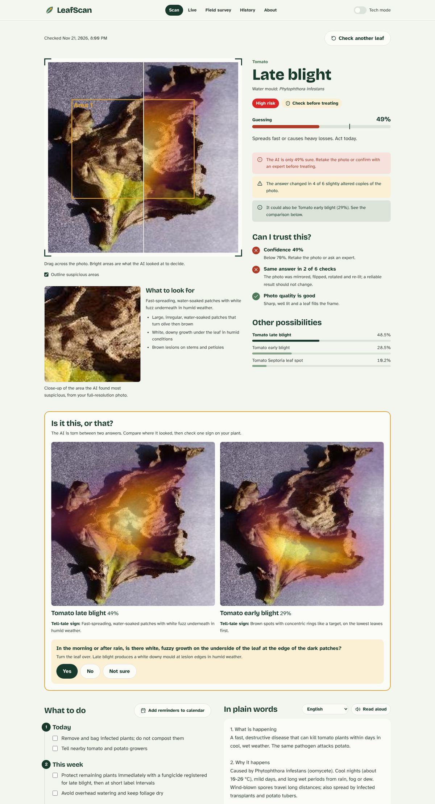
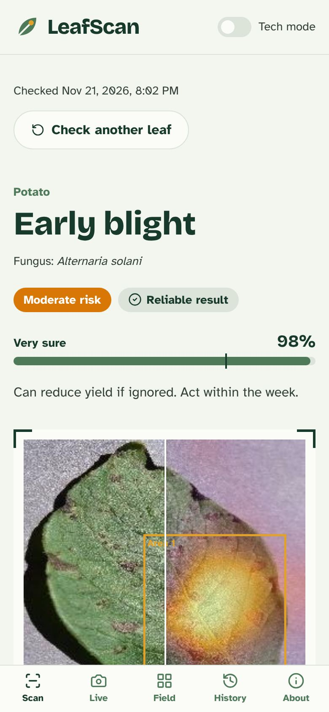
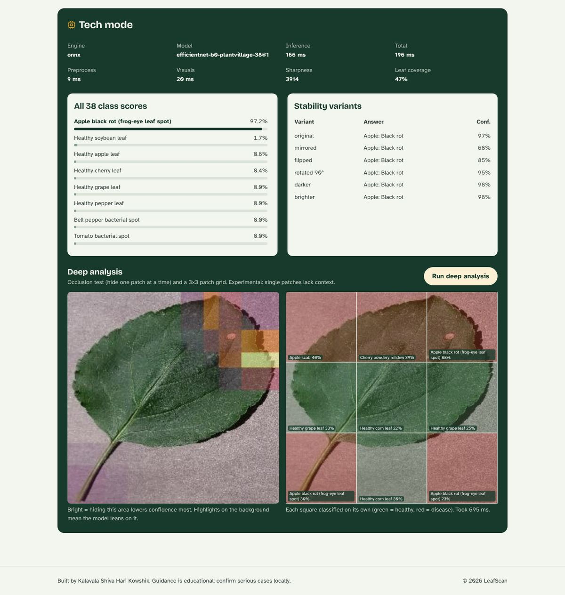

# LeafScan: plant disease detection you can trust

[](https://github.com/kalavalashivaharikowshik/plant-disease-detection-triton/actions/workflows/ci.yml)


Photograph a leaf and LeafScan tells you **which of 38 diseases (or healthy) it shows across 14
crops, how sure it is, where on the leaf it saw the problem, and what to do about it**, with
treatment steps sourced from university and Indian agricultural extension guides.

Most leaf-disease demos print a label and a percentage. LeafScan is built around the question
a farmer actually has: *can I trust this before I spend money on spraying?*



## What it does

| | |
|---|---|
| **Diagnosis** | EfficientNet-B0 (ONNX) classifies 38 classes; the top 3 are always shown. |
| **Heatmap** | A class activation map from the network's own features, with a drag-to-compare slider, outlined suspicious areas and an auto-zoom crop from the full-resolution photo. |
| **Reliability** | A *reliable* mark only when confidence ≥ 70%, the answer survives 6 altered copies of the photo (stability test) and the photo passes blur, exposure and leaf-coverage checks. |
| **"Is it this or that?"** | When two diseases are close, both heatmaps are shown side by side with each one's tell-tale sign, plus one yes/no question that re-ranks the result (Bayesian update). |
| **Action plan** | Today / this week / next two weeks, with checkboxes and calendar reminders (.ics). |
| **Sourced treatment** | Field, organic and chemical options for every class, with links to the extension pages they came from (UMN, UMass, Penn State, UC IPM, UF/IFAS, TNAU, and others). |
| **Plain-language explanation** | Gemini looks at the photo and explains in English, Hindi, Telugu, Tamil, Kannada or Marathi, grounded in the curated notes. Includes read-aloud, and a built-in fallback that always works. |
| **Works offline** | The same model runs in the browser with ONNX Runtime Web. |
| **Live camera** | Point the phone at a plant for on-device predictions with a live heatmap. |
| **Field survey** | Check up to 20 photos at once to see the % healthy and a treat-first list. |
| **History** | Saved on the device, grouped per plant, with a trend over time. |
| **Share** | PDF report, WhatsApp or the phone's share sheet. |
| **Tech mode** | Engine, timings, all 38 scores, stability variants, occlusion test and patch grid. |

<p>
  
  
</p>

## Measured accuracy

Evaluated with the production pipeline on 380 PlantVillage photos (10 per class) using
`scripts/evaluate.py`. Full report: [docs/evaluation.md](docs/evaluation.md).

| Metric | Result |
|---|---|
| Top-1 accuracy | **94.2%** |
| Top-3 accuracy | 100% |
| Accuracy when LeafScan marks a result *reliable* (89.5% of photos) | **99.4%** |
| Accuracy when it shows a warning | 50.0%, so 20 of the 22 errors were flagged |

> PlantVillage shows single leaves on plain backgrounds, and the model was trained on an augmented
> copy of it, so these numbers are optimistic. Expect lower accuracy on field photos. That is why
> the reliability checks exist.

## Architecture

```
Browser (React)  ──/api──▶  FastAPI ──▶ validation ▶ preprocessing ▶ quality check
     │                         │
     │                         ├──▶ Hybrid engine ──▶ NVIDIA Triton (GPU, optional)
     │                         │                  └─▶ ONNX Runtime (CPU, automatic fallback)
     │                         ├──▶ heatmap · regions · zoom · stability · occlusion
     │                         ├──▶ curated knowledge base (38 sourced entries)
     │                         └──▶ explanations: Gemini ▸ Ollama ▸ built-in (cached)
     └── offline / live camera: ONNX Runtime Web (same model, in the browser)
```

See [docs/architecture.md](docs/architecture.md) for the request flow and design decisions.

## Quick start

### Local development

```bash
# Backend (Python 3.12)
cd backend
python -m venv .venv && source .venv/bin/activate
pip install -r requirements-dev.txt
INFERENCE_BACKEND=onnx uvicorn app.main:app --reload --port 8000

# Frontend (Node 20), in another terminal
cd frontend
npm install
npm run dev          # http://localhost:3000, proxies /api to :8000
```

API docs: http://localhost:8000/docs

### Docker Compose

```bash
cp .env.example .env            # optional: add GEMINI_API_KEY
docker compose up --build       # http://localhost:3000

docker compose --profile gpu up --build      # adds NVIDIA Triton (needs the NVIDIA Container Toolkit)
docker compose --profile ollama up --build   # adds Ollama for offline explanations
docker compose exec ollama ollama pull llama3.2:3b
```

Only ports 3000 (website) and 8000 (API) are published; Redis, Triton and Ollama stay private.

## Deploy to Render

The repo includes a [Render Blueprint](render.yaml) that deploys one Docker service (API and
website together, ONNX Runtime on CPU, about 130 MB RAM, so the free plan works).

1. Sign in at [render.com](https://render.com) with GitHub.
2. **New → Blueprint**, then pick this repository and click **Apply**.
3. In the service's **Environment** tab, set `GEMINI_API_KEY` (free key from
   [Google AI Studio](https://aistudio.google.com/apikey)). Without it, the built-in explanations are used.
4. Open `https://<service-name>.onrender.com`. Free instances sleep when idle, so the first request takes about 30–60 s.

## Configuration

All settings are environment variables; see [.env.example](.env.example).

| Variable | Default | Purpose |
|---|---|---|
| `INFERENCE_BACKEND` | `auto` | `onnx`, `triton`, or `auto` (Triton with ONNX fallback) |
| `TRITON_URL` | `http://triton:8000` | Triton HTTP endpoint |
| `CONFIDENCE_THRESHOLD` | `0.70` | Below this, results get a "retake the photo" warning |
| `STABILITY_VARIANTS` | `6` | Altered copies used for the stability test (1–6) |
| `EXPLANATION_PROVIDER` | `auto` | `gemini`, `ollama`, `static` or `auto` |
| `GEMINI_API_KEY` / `GEMINI_MODEL` | – / `gemini-3.8-flash` | Photo-aware multilingual explanations |
| `OLLAMA_URL` / `OLLAMA_MODEL` | – / `llama3.2:3b` | Offline explanations |
| `REDIS_URL` | – | Shared cache; in-memory if empty |
| `API_KEY` | – | If set, `/api` requires the `X-API-Key` header |
| `RATE_LIMIT` | `30/minute` | Per-IP limit on analysis endpoints |
| `MAX_UPLOAD_MB` | `8` | Upload size limit |

## API

| Method | Path | Description |
|---|---|---|
| `POST` | `/api/predict` | Full analysis of one photo (multipart field `image`) |
| `POST` | `/api/predict/deep` | Occlusion test and 3×3 patch grid |
| `POST` | `/api/refine` | Re-rank candidates with follow-up answers |
| `POST` | `/api/explain` | Plain-language explanation (`class_id`, `confidence`, `language`, optional `image`) |
| `GET` | `/api/model/info` | Model card and evaluation |
| `GET` | `/api/model/classes` | The 38 classes with risk levels |
| `GET` | `/api/model/knowledge` | Full knowledge base (used offline) |
| `GET` | `/api/health` · `/api/ready` | Liveness · readiness with engine, cache and provider status |

## Project structure

```
backend/app/
  inference/        ONNX Runtime, Triton (binary protocol) and hybrid engines
  imaging/          upload validation, preprocessing, photo-quality checks
  explainability/   class activation maps, regions, zoom, stability, occlusion
  knowledge/        labels, risk levels, follow-up questions, one JSON file per crop
  explanations/     Gemini / Ollama / built-in providers with caching and fallback
  services/         analysis pipeline, cache, Bayesian refinement
  routers/          health, model, predict, explain
frontend/src/
  components/       layout, upload, result panels
  pages/            Scan, Live, Field survey, History, About, 404
  lib/              API client, on-device engine, history, calendar, speech
model_repository/   Triton model repository (ONNX model + config.pbtxt)
scripts/            model export helper, evaluation
```

## Testing

```bash
cd backend && ruff check app tests && python -m pytest     # 39 tests
cd frontend && npm run lint && npm test && npm run build    # 11 tests
```

GitHub Actions runs all of this, builds the three Docker images, and smoke-tests the
Render image under a 512 MB memory limit.

## Limitations and next steps

- Trained on PlantVillage lab photos; fine-tuning on field photos (for example PlantDoc) is the
  most valuable next step.
- There is no "not a leaf" class yet; the quality check and confidence threshold catch most such photos.
- "Risk level" describes the disease type, not how much of this leaf is infected. Measuring lesion
  area needs a segmentation model.
- Treatment guidance is educational. Always follow the product label and your local agriculture
  officer or Krishi Vigyan Kendra.

## Credits

- Dataset: [PlantVillage](https://github.com/spMohanty/PlantVillage-Dataset) (Hughes & Salathé) and the
  augmented *New Plant Diseases Dataset* used for training.
- Treatment guidance: extension publications linked from each result.
- Heatmap method: Zhou et al., *Learning Deep Features for Discriminative Localization* (CVPR 2016).

## License

[MIT](LICENSE) © Kalavala Shiva Hari Kowshik
