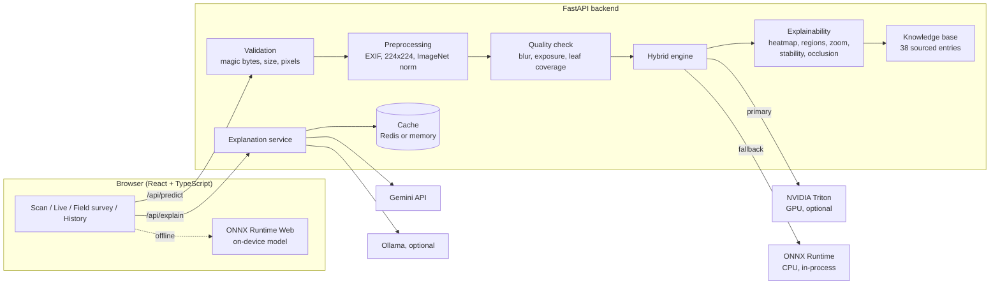

# Architecture

LeafScan is a hybrid system: the same ONNX model runs in three places, and the app
picks the best one available.

## Request flow (`POST /api/predict`)

1. **Validation**: the upload is checked by its bytes (JPEG/PNG/WebP magic numbers), size
   (8 MB) and resolution (40 MP), so corrupt files and decompression bombs get a clear 4xx.
2. **Preprocessing**: EXIF rotation is applied, then the image is resized to 224x224,
   scaled to [0, 1], ImageNet-normalised and laid out as NCHW float32, exactly as in training.
3. **One batched inference**: the original plus up to five altered copies (mirrored,
   flipped, rotated, darker, brighter) run in a single model call. The original gives the
   prediction; the copies give the **stability** score.
4. **Explainability**: the model exposes its last feature map (`features`, 1280x7x7). With
   the classifier weights this gives a class activation map (CAM). Regions are found on
   leaf pixels only, and the hottest area is cropped from the full-resolution photo.
5. **Reliability**: confidence below 70%, an unstable answer or a quality problem turns off
   the "reliable" mark and adds a warning. When the top two classes are close, the
   response includes both candidates' heatmaps and a follow-up question.
6. **Knowledge**: the predicted class is looked up in the curated knowledge base
   (`backend/app/knowledge/crops/*.json`), which supplies risk level, symptoms, a dated
   action plan, treatment options and sources.

The AI explanation is fetched separately (`POST /api/explain`) so the result appears
immediately. Providers are tried in order (Gemini, then Ollama); if all fail, the
built-in summary is used. Only successful AI answers are cached.

## Inference engines

| Mode (`INFERENCE_BACKEND`) | Behaviour |
|---|---|
| `onnx` | In-process ONNX Runtime (CPU, or CUDA if present). Used on Render. |
| `triton` | NVIDIA Triton over HTTP with the binary tensor protocol (~0.6 MB per image instead of ~3 MB JSON). |
| `auto` | Hybrid: Triton first; on failure, ONNX Runtime with a 30 s cooldown before retrying Triton. |

In the browser, ONNX Runtime Web runs the same model for offline mode and the live camera.
The model, classifier weights and knowledge base are cached after the first download.

## Follow-up refinement

`POST /api/refine` applies Bayes' rule over the candidate classes:

    P(class | answers) ∝ P(class | image) × Π P(answer | class)

The likelihoods live in `backend/app/knowledge/meta.json`. The next question is the one
whose likelihoods differ most between the top two candidates.

## Deployment shapes

| Shape | Files | Notes |
|---|---|---|
| Render (single container) | `Dockerfile`, `render.yaml` | FastAPI serves the API and the built site. About 130 MB RAM. |
| Docker Compose (CPU) | `docker-compose.yml` | nginx frontend + API + Redis. |
| Docker Compose (GPU) | `--profile gpu` | Adds Triton with GPU reservation; the API switches automatically. |
| Offline LLM | `--profile ollama` | Adds Ollama; set `OLLAMA_URL=http://ollama:11434`. |
